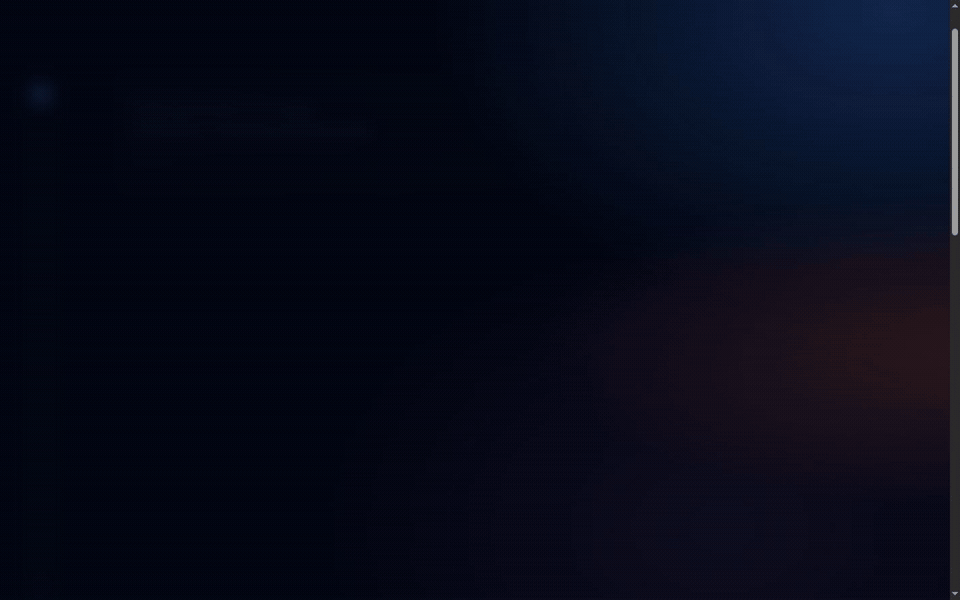

# Framecost — animações automáticas 1.3.0

Os efeitos começam ao abrir a plataforma e acompanham a navegação, a rolagem e o mouse. Não existe botão liga/desliga nem dependência de uma escolha salva anteriormente.

## Efeitos

- Entrada em cascata com deslocamento de até 70px, desfoque, escala e acomodação final. Cards maiores usam 1,1s; elementos menores, 0,8s. A sequência adiciona até 390ms entre os primeiros elementos visíveis.
- Elementos abaixo da tela aparecem ao entrar na área visível. O conteúdo continua ocupando seu espaço antes de aparecer, para manter o tamanho da página estável.
- Cards, modelos e opções de resolução ganham reflexos azul/ciano/violeta, gotas com rastro elástico, ondas e inclinação suave seguindo o cursor.
- A superfície retorna ao repouso quando o mouse sai ou a página rola. O laço de atualização para quando o movimento termina e é cancelado ao redesenhar os resultados.
- Campos em edição mantêm a superfície estável e o foco. O histórico de entrada é preservado durante os recálculos; mudar um número não reinicia a animação da página.
- Diálogos entram com desfoque e escala. Animações decorativas de fundo via CSS respeitam prefers-reduced-motion; as entradas e interações solicitadas permanecem automáticas.
- Em toque, o efeito de mouse é desativado. As animações de entrada e rolagem continuam automáticas.

Os efeitos usam APIs nativas do navegador, sem CDN ou pacote adicional. dist/motion.mjs cuida dos observadores e da superfície; dist/motion.css contém a apresentação. Catálogo, motor financeiro, segmentação, comparação e rotina de preservação da digitação não foram alterados. Sem IntersectionObserver ou animação nativa, o conteúdo permanece visível.

## QA — 23/10/2026

Prévia local: http://127.0.0.1:4178. Resultado funcional: **SHIP** para o escopo abaixo.

| Verificação | Resultado |
| --- | --- |
| Inicialização automática | mode=automatic, controle de ativação ausente; entradas iniciadas sem clique de ativação |
| Rolagem | Alvos abaixo da tela inicialmente pending; depois da rolagem completa, nenhum alvo pending |
| Vidro líquido | Cards de plano e custo apresentaram liquid-active durante a gravação, com reflexo e rastro |
| Digitação | 15 permaneceu 15; foco em gen.duration; cabeçalho e modelos continuaram done; 0 entradas em execução após a edição observada |
| Celular, 375px | Quatro telas sem overflow horizontal; largura útil e scrollWidth=360px; navegação inferior visível após a entrada |
| Tablet, 768px | Quatro telas sem overflow horizontal; largura útil e scrollWidth=753px |
| Desktop, 1440px | Quatro telas sem overflow horizontal; largura útil e scrollWidth=1425px |
| Diálogo de saldo | Abertura e fechamento normais |
| Console | 0 erros e 0 avisos nos cenários observados |
| Build | Sintaxe de oito módulos, saída estática e 94 testes aprovados |

A captura usa 80 quadros reais do navegador, com tempos registrados, incluindo entrada, mouse nos cards e rolagem. A prévia abaixo tem resolução e taxa de quadros reduzidas para compartilhamento. Não é uma medição de FPS da aplicação. Core Web Vitals, axe-core e comparação automatizada por pixels não foram executados nesta revisão. A equivalência visual automatizada é inconclusiva para elementos em movimento; as dimensões e os estados foram conferidos no navegador.

[Captura do vidro líquido](docs/motion-1.3.0/liquido.png). O rodapé identifica a versão 1.3.0. A configuração para Vercel permanece estática, sem variáveis de ambiente ou instalação adicional.
