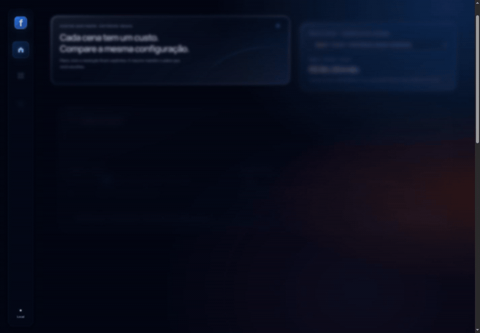

# Framecost — Liquid Glass 1.4.0

Os cards agora recebem um acabamento web inspirado no Liquid Glass: corpo translúcido, desfoque e saturação do fundo, cantos mais arredondados, borda com espessura aparente e reflexos de luz branca. A paleta azul marinho e os acentos azul, violeta e âmbar continuam presentes.

O vidro aparece mesmo em repouso. Com mouse, o reflexo acompanha o cursor e deixa um rastro elástico; a borda muda conforme a posição da luz, e o card se inclina suavemente. O cabeçalho principal também recebe o material. As entradas e a revelação durante a rolagem continuam automáticas, sem controle de ativação.

## Implementação

- `dist/motion.css` define o material, os reflexos e o acabamento das bordas. São composições de CSS; não há renderização física de refração ou uso de APIs nativas da Apple.
- `dist/motion.mjs` instala uma superfície decorativa por card em qualquer tipo de ponteiro. O acompanhamento do mouse só é criado em dispositivos com ponteiro fino e hover.
- Texto e campos permanecem em suas posições. A superfície decorativa é ignorada pela acessibilidade e não intercepta cliques. O card fica estável enquanto um campo contém o foco.
- Escolhas dentro de um card reutilizam o desfoque do pai. A atualização do movimento para ao chegar ao repouso. As superfícies são removidas antes de cada redesenho e recriadas sem duplicação.
- Navegadores sem backdrop-filter usam um corpo mais opaco. Sem máscara composta, a borda usa o acabamento básico. A impressão remove reflexos, desfoque e sombras.
- Catálogo, motor financeiro, segmentação, comparação e preservação do campo digitado permanecem sem alterações.

## Validação — 24/10/2026

Prévia local servida em `http://127.0.0.1:4178/`, conferida no navegador integrado.

| Verificação | Resultado |
| --- | --- |
| Quatro telas, 375px | Sem overflow horizontal; largura útil e scrollWidth de 360px |
| Quatro telas, 768px | Sem overflow horizontal; largura útil e scrollWidth de 753px |
| Quatro telas, 1440px | Sem overflow horizontal; largura útil e scrollWidth de 1425px |
| Material | blur(24px), saturate(1.55), preenchimento translúcido e borda especular observados nos cards |
| Superfícies | 19 em Gerações, 6 em Projetos, 6 em Planos, 23 em Fontes; exatamente uma por card |
| Mouse | Plano em foco recebeu liquid-active; posição do reflexo e transformação responderam ao ponteiro |
| Digitação | Entrada sequencial de 15 resultou em 15; foco mantido em gen.duration; modelos continuaram done |
| Rolagem | Após percorrer Gerações até o rodapé, nenhum alvo permaneceu pending |
| Diálogo | Saldo abriu e fechou normalmente |
| Orçamento | Posição sticky no desktop e static nos layouts menores |
| Console | Nenhum erro ou aviso nos cenários observados |
| Build | Sintaxe, arquivos estáticos e 94 testes aprovados |

Os tamanhos mobile e tablet foram conferidos por ajuste de viewport. Não houve teste em aparelho físico, Safari, impressão real, medição de FPS, Core Web Vitals ou auditoria automatizada de acessibilidade nesta revisão.

## Prévia

[Desktop](docs/glass-1.4.0/desktop.png), [mobile](docs/glass-1.4.0/mobile.png) e [Projetos](docs/glass-1.4.0/projetos.png).

A gravação usa 64 quadros reais com tempos registrados. A resolução e a taxa de quadros do GIF foram reduzidas para compartilhamento. A Vercel continua usando a saída estática dist, sem instalação ou variáveis adicionais.
